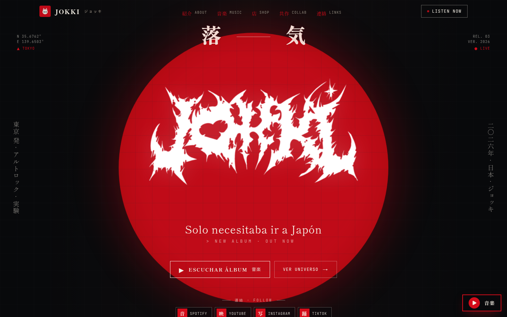
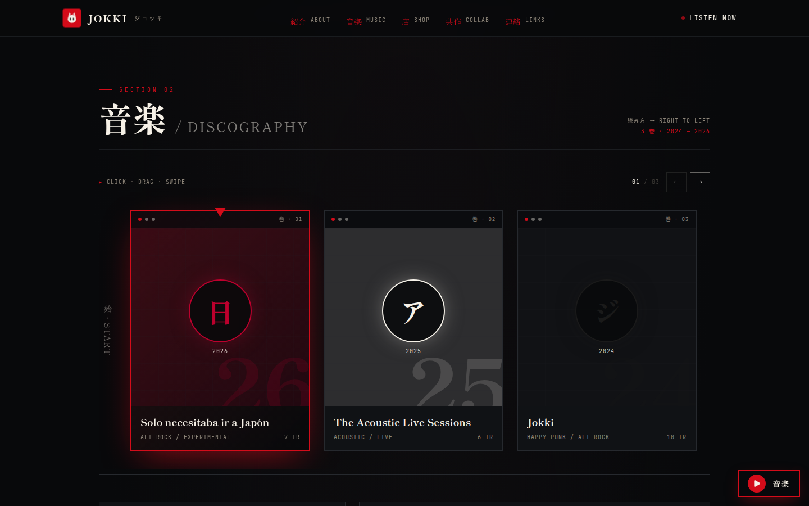
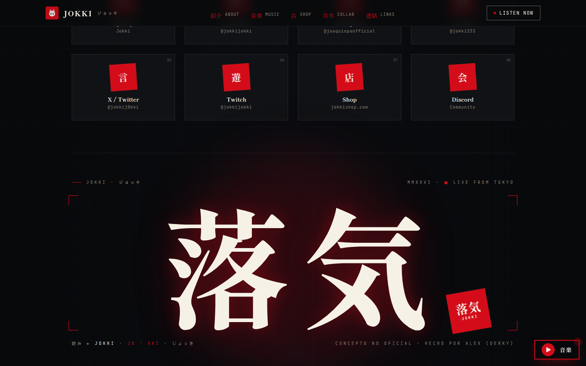

# jokki-concept

Concepto de web-portfolio para **Jokki**, un artista de alt-rock, electrónica y hip-hop afincado en Tokio. Es un proyecto personal de diseño y frontend: **no es oficial, el artista no lo usa y no estoy afiliado a él**. El nombre, la música y la imagen son suyos.



## La idea

Una web que mezcle la estética japonesa del artista (hinomaru, kanji, sellos hanko, papel washi, tinta sumi) con guiños a la consola portátil y al manga:

- **Portada** con el círculo hinomaru, firma en kanji 落気 animada como un trazo de pincel y texto vertical (tategaki).
- **Discografía** como una tira de manga que se lee de derecha a izquierda, con previews de las canciones y su popularidad en Spotify.
- **Cursor de tinta**: el ratón deja una estela de pincel sumi que se adelgaza al ir más rápido.
- **Código Konami**: activa un "modo DS" con marco de consola, HUD y líneas de escaneo.
- **Reproductor de Spotify** flotante, vídeos con marco de pantalla CRT, tienda, colaboraciones y redes como sellos hanko.



## Stack

- Next.js 16 (App Router) y React 19, TypeScript
- Tailwind CSS v4 y motion para las animaciones
- API de Spotify (client credentials) en el servidor, con caché del token. Sin credenciales, la discografía usa la lista estática.

## Ejecutar

```bash
pnpm install
cp .env.example .env.local   # opcional: credenciales de Spotify
pnpm dev                     # http://localhost:3000
```

La web lleva `noindex` y el aviso de "concepto no oficial" en el pie, para que nadie la confunda con la página del artista.


